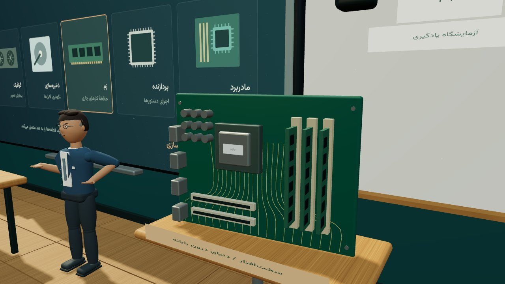
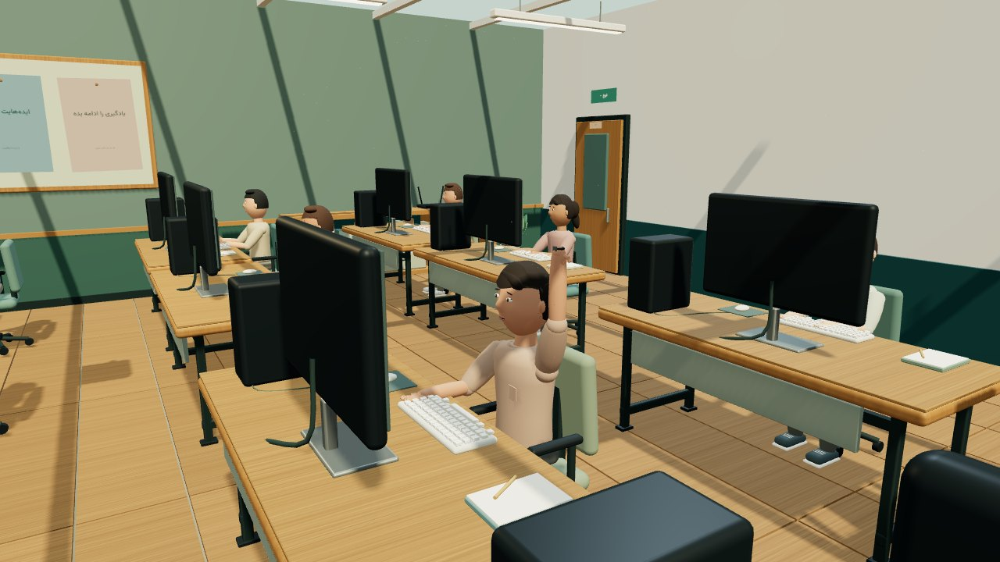
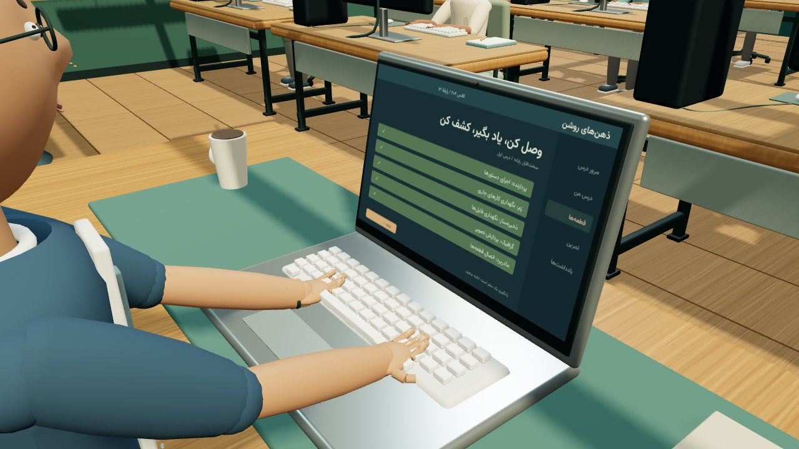
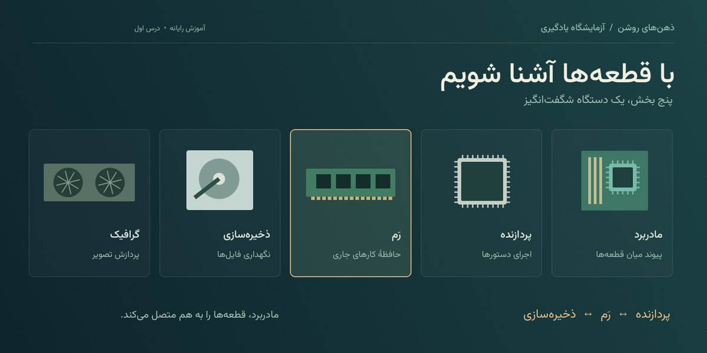
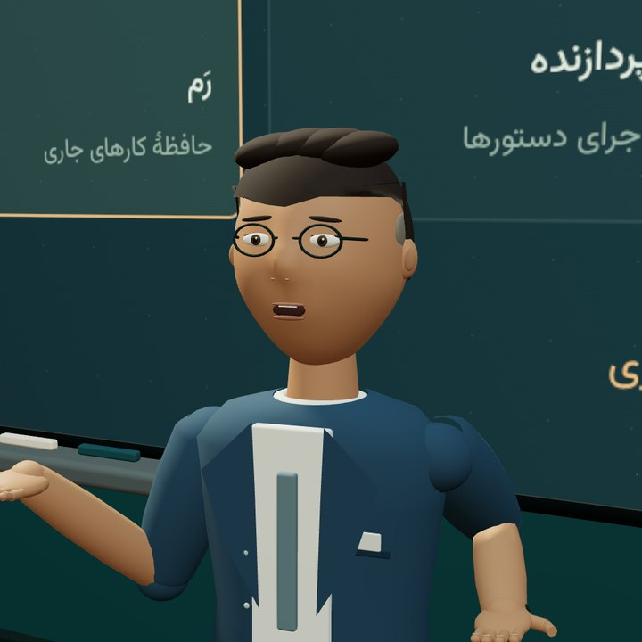
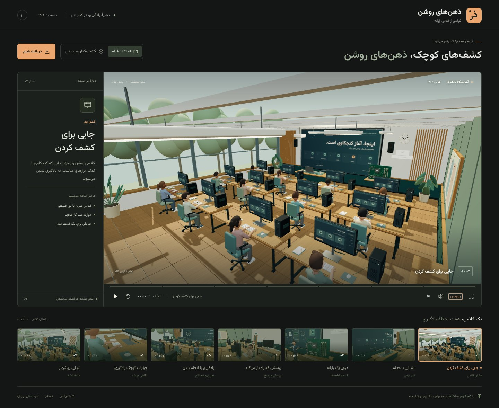
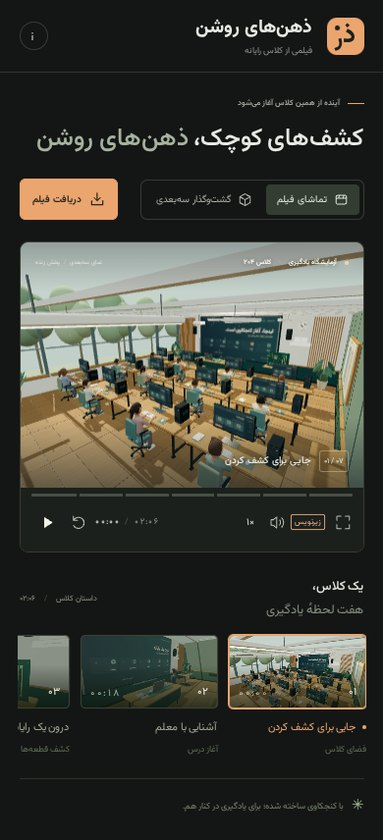

# ذهن‌های روشن — فیلم فارسی کلاس رایانه

فیلم تعاملی سه‌بعدی با **۷ فصل، ۱۶ نمای دوربین، ۱۲ دانش‌آموز و یک معلم**؛ زمان کامل **۲ دقیقه و ۶ ثانیه** است.

رابط، زیرنویس‌ها، تختهٔ کلاس، نمایشگرهای رایانه و نوشته‌های محیط فارسی هستند. چهره‌ها، موها، لباس‌ها و دست‌ها بازطراحی شده‌اند و پلک‌زدن و حرکت دهان، به شخصیت‌ها جان می‌دهند. سبک تصویر، پویانمایی سه‌بعدی است.

## نمایش زنده

**<https://rayanerfan.github.io/bright-minds-classroom-film/>**



## تصاویر

| پرسش دانش‌آموز | نمای نزدیک دست‌ها |
| --- | --- |
|  |  |

| تختهٔ فارسی درس | چهرهٔ معلم |
| --- | --- |
|  |  |

| پخش‌کنندهٔ فیلم | نسخهٔ موبایل |
| --- | --- |
|  |  |

## تماشا

```sh
npm install
npm run dev
```

آدرس **http://localhost:4175** را باز کنید و دکمهٔ **«پخش فیلم با صدای فارسی»** را بزنید. این کلیک برای اجازهٔ پخش صدا در مرورگر لازم است.

- **تماشای فیلم:** دوربین و حرکت شخصیت‌ها طبق داستان جلو می‌روند.
- **گشت‌وگذار سه‌بعدی:** با کشیدن و پیمایش، کلاس را از زاویه‌های مختلف ببینید.
- **زیرنویس:** متن فارسی گفت‌وگوها را نشان می‌دهد.
- **دریافت فیلم:** ویدیوی ۱۰۸۰ با صدا را در قالب WebM ضبط می‌کند. برگه باید تا پایان ضبط باز بماند.

کلید فاصله برای پخش و مکث، کلیدهای جهت برای جابه‌جایی پنج ثانیه، F برای تمام‌صفحه، M برای صدا و C برای زیرنویس هستند.

## صداهای فارسی

**۱۹ قطعهٔ گفتار** با دو صدای مصنوعی جداگانه و لهجهٔ فارسی ایرانی تولید و داخل پروژه ذخیره شده‌اند:

| نقش | صدا |
| --- | --- |
| معلم و راوی | مردانه، `fa-IR-FaridNeural` |
| دانش‌آموز | زنانه، `fa-IR-DilaraNeural` |

فایل کامل گفت‌وگو و موسیقی: `public/audio/classroom-fa.mp3`

صدای ضبط‌شده، ساعت اصلی فیلم است؛ بنابراین مکث، جابه‌جایی و تغییر سرعت، تصویر و صدا را از هم جدا نمی‌کند. حرکت دهان از شدت واقعی گفتار در هر لحظه محاسبه می‌شود. هنگام پرسش دانش‌آموز، دهان معلم بسته است و هنگام پاسخ، نقش‌ها عوض می‌شوند.

صدا هنگام تماشا یا دریافت ویدیو به سرویس بیرونی متصل نمی‌شود. هیچ حساب یا کلید API برای تماشای فیلم لازم نیست.

برای تولید دوبارهٔ صدا پس از تغییر دیالوگ‌ها:

```sh
python3 -m venv .voice-venv
.voice-venv/bin/pip install edge-tts
.voice-venv/bin/python scripts/generate-voices.py
```

این مرحله به اینترنت نیاز دارد و فقط متن آموزشی نوشته‌شده در `scripts/dialogue-fa.json` را برای تبدیل به گفتار ارسال می‌کند. برای بازتولید یک جملهٔ ویرایش‌شده، فایل متناظر `public/audio/raw-NN.mp3` را حذف کنید. زمان‌بندی صدا و دادهٔ حرکت دهان دوباره ساخته می‌شوند. آهنگ پس‌زمینهٔ موجود در `artifacts/bright-minds-score.wav` اختیاری است؛ بدون آن هم گفت‌وگو تولید می‌شود.

## فصل‌ها

| آغاز | موضوع |
| --- | --- |
| ۰۰:۰۰ | معرفی کلاس |
| ۰۰:۱۸ | ورود معلم و شروع درس |
| ۰۰:۳۶ | آشنایی با قطعه‌های رایانه |
| ۰۰:۵۴ | پرسش دانش‌آموز و پاسخ معلم |
| ۰۱:۱۲ | تمرین عملی و کمک معلم |
| ۰۱:۳۰ | نماهای نزدیک از دست‌ها و تجهیزات |
| ۰۱:۴۸ | جمع‌بندی و پایان کلاس |

## ساخت و آزمایش

```sh
npm run build
npm run preview
```

پوشهٔ `dist/` شامل سایت مستقل، کتابخانهٔ Three.js، قلم فارسی و تمام صداهاست و روی هر میزبان وب ایستا اجرا می‌شود. همهٔ مسیرها نسبی‌اند، بنابراین فیلم در زیرمسیر (مانند GitHub Pages) هم درست باز می‌شود. Node.js نسخهٔ ۲۲ یا جدیدتر پیشنهاد می‌شود.

```sh
sh scripts/publish-pages.sh   # ساخت و انتشار روی شاخهٔ gh-pages
```

برای آزمایش مرورگری، ابتدا سرور را اجرا کنید و ابزار اختیاری Playwright را نصب کنید:

```sh
npm install --no-save playwright
npx playwright install chromium
npm test
```

آزمایش‌ها راست‌به‌چپ بودن صفحه، نبود سرریز در موبایل، دو صدای متفاوت، زمان‌بندی جمله‌ها، محدودهٔ هندسی صورت در حین گفتار، حرکت دهان، مکث، جابه‌جایی، سرعت، بی‌صداکردن، زیرنویس و ضبط واقعی صدای دانش‌آموز را بررسی می‌کنند. تصاویر و گزارش در `artifacts/persian/` ذخیره می‌شوند. متغیر `BASE_URL` برای آزمایش روی آدرس دیگر قابل تنظیم است.

```sh
npm run test:export  # یک ضبط کوتاه واقعی می‌گیرد و دانلود ویدیو با صدا را بررسی می‌کند
npm run shots        # تصاویر صحنه‌ها و چیدمان را در artifacts/ می‌سازد
```

## خروجی MP4

اسکریپت زیر با Playwright و FFmpeg، تک‌تک فریم‌ها را همراه با صدای فارسی به MP4 تبدیل می‌کند. زمان لازم به توان گرافیکی دستگاه بستگی دارد:

```sh
npm run render
```

خروجی پیش‌فرض: `artifacts/bright-minds-classroom-fa.mp4`، وضوح ۱۹۲۰×۱۰۸۰، نرخ ۲۴ فریم بر ثانیه. متغیرهای `FPS`، `DURATION` و `OUTPUT` برای نمونه‌های کوتاه قابل تنظیم‌اند.

## فایل‌های اصلی

- `src/characters.js`: چهره‌ها، موها، لباس‌ها، دست‌ها، پلک و حرکت دهان
- `src/speech-audio.js`: پخش گفتار، همگام‌سازی و اتصال صدا به خروجی ویدیو
- `src/voice-timing.js`: شدت گفتار و زمان‌بندی تولیدشده برای حرکت دهان
- `src/world.js`: محیط کلاس، تجهیزات و حرکت معلم
- `src/textures.js`: تخته و نمایشگرهای فارسی
- `src/story.js`: فصل‌ها و زیرنویس‌ها
- `src/main.js`: پخش، رابط و خروجی ویدیو
- `scripts/dialogue-fa.json`: متن دیالوگ‌های فارسی

مجوز قلم‌ها در `public/fonts/LICENSES.md` و مجوز Three.js در بستهٔ آن و خروجی سایت قرار دارد.

## ساختار مخزن

```
index.html          صفحهٔ فیلم
src/                صحنه، شخصیت‌ها، تخته، صدا، رابط و کارگردانی دوربین
public/             قلم‌های فارسی، صداهای تولیدشده، تصاویر فصل‌ها و آیکون
scripts/            سرور محلی، ساخت، آزمایش مرورگری، تولید صدا و رندر MP4
dist/               سایت مستقل و آمادهٔ انتشار (خروجی npm run build)
media/              تصاویر همین توضیحات
```

## مجوز

کد این پروژه با مجوز **MIT** منتشر شده است؛ فایل `LICENSE` را ببینید. قلم Vazirmatn و Space Grotesk با مجوز OFL و Three.js با مجوز MIT عرضه شده‌اند. متن گفت‌وگوها، مدل‌ها، بافت‌ها و موسیقی این فیلم اصیل و تولیدشده برای همین پروژه‌اند.
